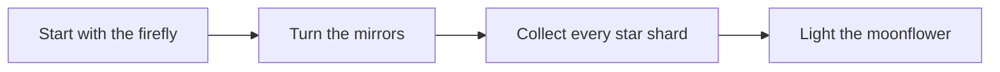

# Lunaria: The Long Way Home

[**Play Lunaria**](https://lunaria-the-long-way-home.onrender.com)

A firefly has lost its way home. Turn the mirrors to guide its beam through every star shard and into the moonflower.

## How to play



- Click a mirror, or focus it and press **Enter**, to rotate it.
- Press **H** for a hint and **R** to restart the stage.
- Pick any of the **10 stages**. Each one adds a little more to think about: extra mirrors, more star shards, and trickier starting angles.
- The beam and collected stars update as you play, so you can see what each move changes.

## Play on your computer

The game is plain HTML, CSS, and JavaScript. There is nothing to install.

1. Download or clone this repository.
2. Open `index.html` in a modern browser.
3. If your browser blocks anything when opening the file directly, run this from the project folder:

   ```bash
   python -m http.server 8000
   ```

4. Visit [http://localhost:8000](http://localhost:8000).

## What carries over

Completed stages and your best move counts are saved in this browser. They do not sync between different browsers or devices.

## A few design choices

The puzzle board gets most of the screen because that is where the game happens. A bright beam, clear mirror controls, and stars that light up make the route easy to follow. The dark, moonlit colors keep the game feeling like a little night journey rather than a settings screen.

The layout works with mouse or keyboard, adapts to smaller screens, and respects reduced-motion preferences. The artwork and interface are part of the project; the game does not need external assets or packages.

## How it is hosted

The live version is on [Render](https://lunaria-the-long-way-home.onrender.com). The `render.yaml` file tells Render to serve the project as a static site. New commits pushed to `main` deploy automatically.

## Project files

- `index.html` — the page and game controls
- `styles.css` — the board, layout, and visual effects
- `app.js` — mirror puzzles, stages, hints, and saved progress
- `render.yaml` — Render's static-site setup
